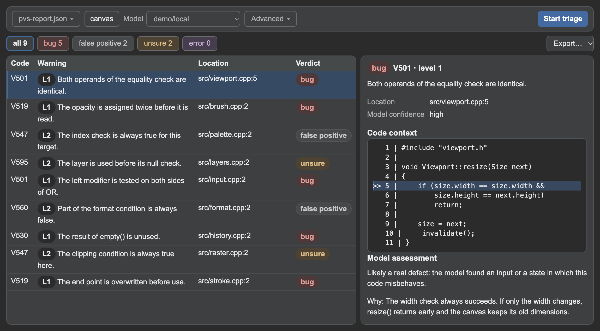

# Triage Report

A desktop app that triages PVS-Studio JSON reports with OpenCode and displays the results. Open saved JSON or CSV results to review verdicts offline. Exports omit source code.

Requires Node.js 24+. New analyses also require OpenCode installed and logged in. Run `npm install` then `npm start`.

Push a `v*` tag to build and publish desktop archives to GitHub Releases.
